<p align="center">
  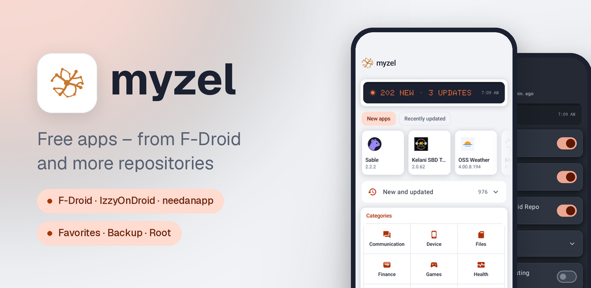
</p>

<p align="center"><a href="README.md">Deutsch</a> · <b>English</b></p>

# Myzel

**App store for free software from F-Droid repositories – for Wear OS watches too**

Myzel is an app store for Android 12 and newer. It brings you free and open-source apps from F-Droid, IzzyOnDroid
and more repositories, installs them and keeps them up to date – on your phone and on your watch. Myzel is based on
the official F-Droid client (currently version 2.0.3) and follows its updates, but wears the design of
needanapp.de.

<p>
  <a href="https://apps.needanapp.de"></a>
  <a href="https://apps.obtainium.imranr.dev/redirect?r=obtainium://add/https://github.com/needanapp-de/myzel"></a>
</p>

[F-Droid repository](https://apps.needanapp.de) · [Myzel in the repository](https://apps.needanapp.de/de.needanapp.myzel/) ·
Android 12 and newer · Wear OS 3 and newer · License [GPL-3.0](LICENSE) · Published by needanapp.de

## Install

Myzel is available in the F-Droid repository of needanapp.de. Add this address under “Repositories” in an F-Droid
app (F-Droid, Droid-ify, Neo Store …) or scan the QR code on [apps.needanapp.de](https://apps.needanapp.de), then
install Myzel. From then on Myzel updates itself.

```text
https://apps.needanapp.de/repo?fingerprint=35453386642F44485E4D556E1F631A1F2AD22CA3B02FB2C72B0A9807E5B30488
```

Fingerprint (SHA-256) of the repository key:
`35 45 33 86 64 2F 44 48 5E 4D 55 6E 1F 63 1A 1F 2A D2 2C A3 B0 2F B2 C7 2B 0A 98 07 E5 B3 04 88`

Until October 2026 Myzel lived at fdroid.needanapp.de. That is now the testing repository with pre-releases and
requires a login. If it is the only one you added, add apps.needanapp.de as shown above; from Myzel 0.22.0 on this
happens on the first start by itself.

The app is signed with the key of needanapp.de (SHA-256 of the certificate):
`C6:0E:A3:B5:6D:A7:0E:60:EF:F5:CB:96:DD:8D:C1:9A:41:86:0A:3E:D4:B2:9A:EB:2A:29:9F:83:3A:63:51:D9`

Up to 0.21.1 Myzel carried a different key (`4C:A4:F7:4F:…:D6:FE:D5:47:02`), which the pre-releases from the
testing repository still carry. An older installation therefore can't be updated to 0.22.0: back up your settings
under Settings › Backup, uninstall Myzel once and install it again from apps.needanapp.de; the same goes for Myzel
Wear on the watch.

You don't need to install the watch app yourself: Myzel fetches it from the same repository when you set up the
watch and keeps it up to date.

## Google Play Protect warning

On phones with Google services, Play Protect may report Myzel as a “harmful app” or “unsafe app”, block the
installation or later suggest uninstalling it. Myzel is not malware. The warning has two reasons:

- **ADB for the watch:** To bring Myzel onto a Wear OS watch, Myzel contains an ADB client
  ([libadb-android](https://github.com/MuntashirAkon/libadb-android)). This is the same technique developers use to put
  apps on a device via “Wireless debugging”. Play Protect rates apps that can do this as risky across the board,
  especially when they don't come from the Play Store.
- **Permissions of an app store:** Myzel installs, updates and removes apps, and for that sees which apps are
  installed. Every app store needs this, yet Play Protect judges it strictly for apps it doesn't know.

What Myzel does with ADB and what it doesn't:

- ADB is only used to set up the watch, and you start that yourself: you turn on “Wireless debugging” on the watch
  and enter the watch's pairing code in Myzel.
- Myzel only connects to a watch. It refuses a phone or tablet with “Wireless debugging”.
- On the watch, Myzel only installs Myzel Wear, gives it the permissions it needs (Bluetooth, notifications,
  installing apps) and hands over a key. Then Myzel turns “Wireless debugging” on the watch off again. Everything
  after that runs over Bluetooth between Myzel and Myzel Wear.
- Myzel doesn't use ADB on the phone itself. It sends no data to third parties and contains no ads, no tracking and
  no crash reports.
- The source code is open in this repository, and the app is signed with the key of needanapp.de (fingerprint above
  under “Install”).

How to install Myzel anyway:

1. Only download Myzel from apps.needanapp.de or from the releases of this page. To be sure, compare the signature of
   the APK with the fingerprint above, for example with `apksigner verify --print-certs myzel-<version>.apk`.
2. If the Play Protect warning appears while installing, tap “More details” and then “Install anyway”. The labels
   differ slightly between Android versions. Whether you send the app to Google for a scan is up to you; it doesn't
   change Myzel.
3. If Play Protect blocked the installation completely or disabled Myzel: open the Play Store, tap your profile
   picture at the top right, then “Play Protect” and the gear, and turn off “Scan apps with Play Protect” for the
   moment. Install Myzel and turn the scan back on afterwards. If Play Protect reports Myzel again later, choose to
   keep the app there.

## Screenshots

<table>
  <tr>
    <td align="center" width="25%">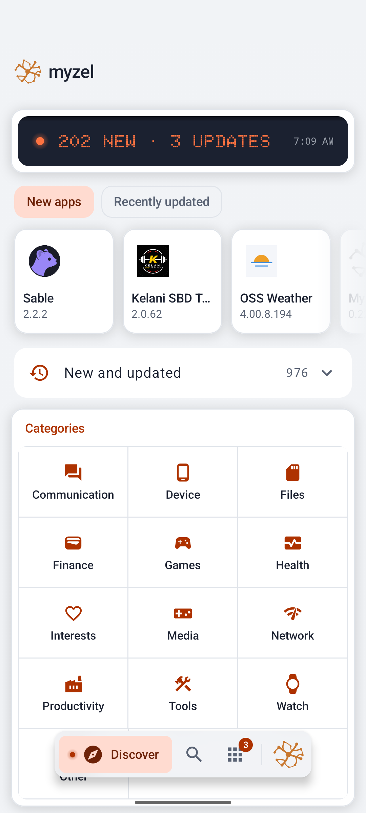<br><sub>Discover: new and updated apps, categories</sub></td>
    <td align="center" width="25%">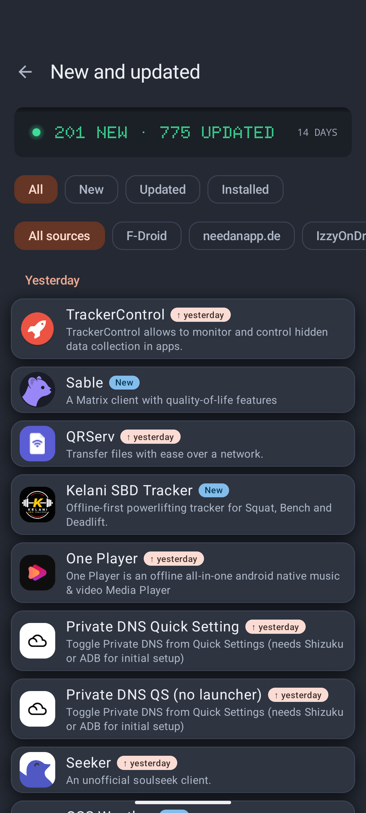<br><sub>New and updated, across all repositories</sub></td>
    <td align="center" width="25%">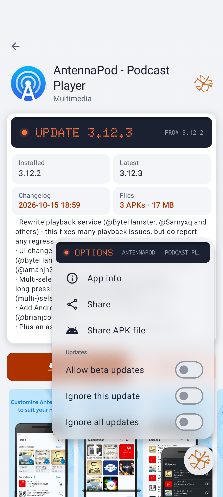<br><sub>App page with options: beta updates, ignore an update</sub></td>
    <td align="center" width="25%">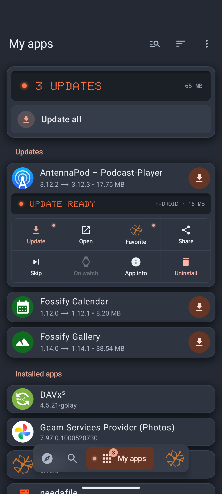<br><sub>My apps: the menu on a long press on an app</sub></td>
  </tr>
  <tr>
    <td align="center" width="25%">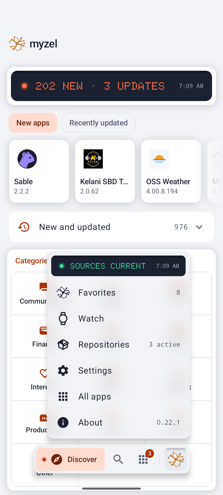<br><sub>The Myzel menu: favorites, watch, repositories</sub></td>
    <td align="center" width="25%">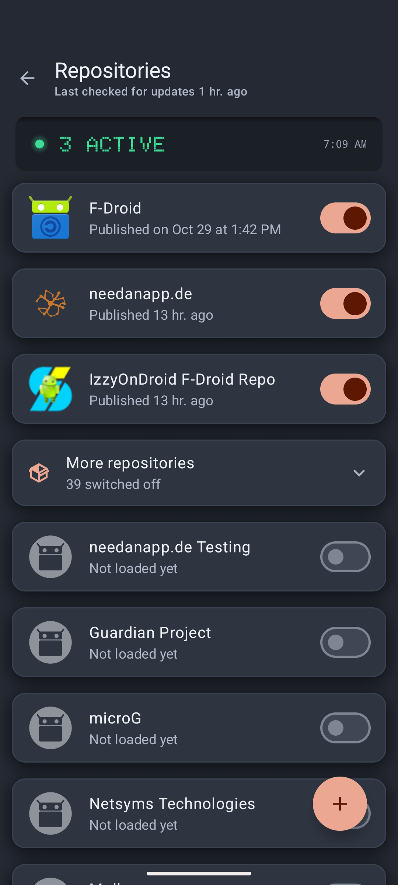<br><sub>Switch repositories on and off or add them</sub></td>
    <td align="center" width="25%">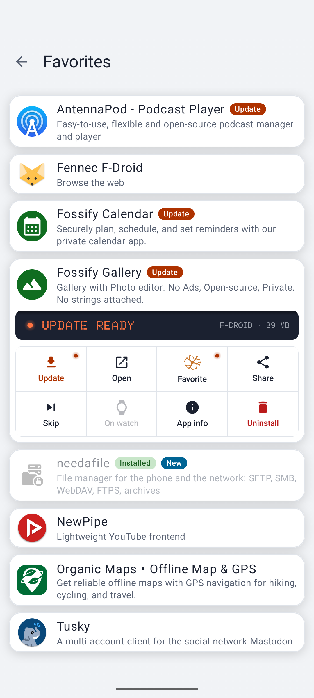<br><sub>Favorites with the menu on a long press</sub></td>
    <td align="center" width="25%">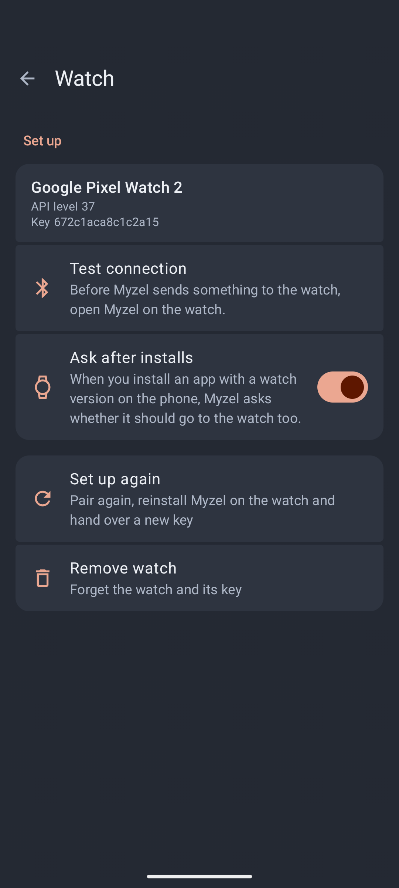<br><sub>Set up a Wear OS watch and test the connection</sub></td>
  </tr>
  <tr>
    <td align="center" width="25%">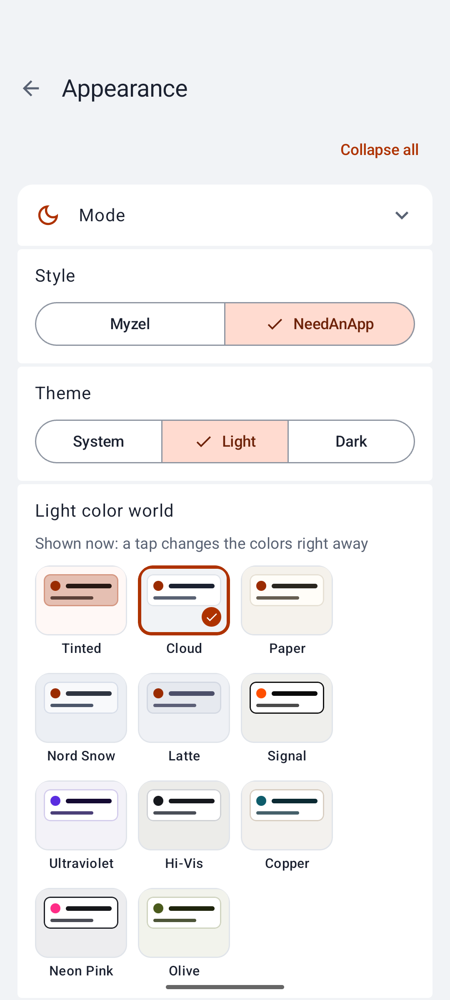<br><sub>Appearance: style, light, dark, color worlds</sub></td>
    <td align="center" width="25%">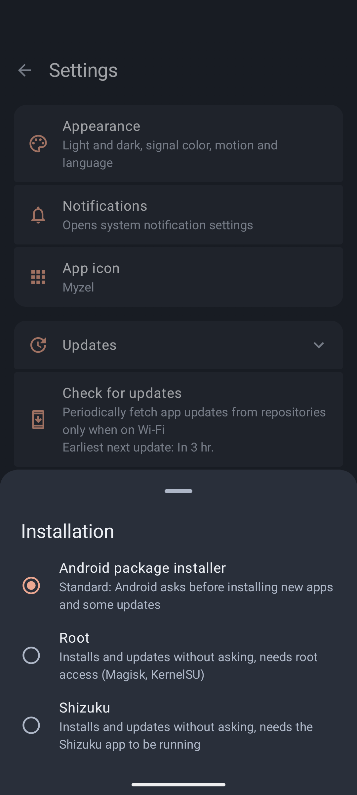<br><sub>Install without asking via root or Shizuku</sub></td>
    <td align="center" width="25%">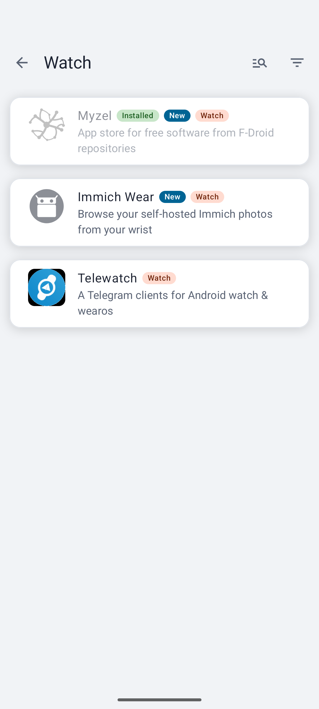<br><sub>Category “Watch”: apps with a watch version</sub></td>
    <td align="center" width="25%">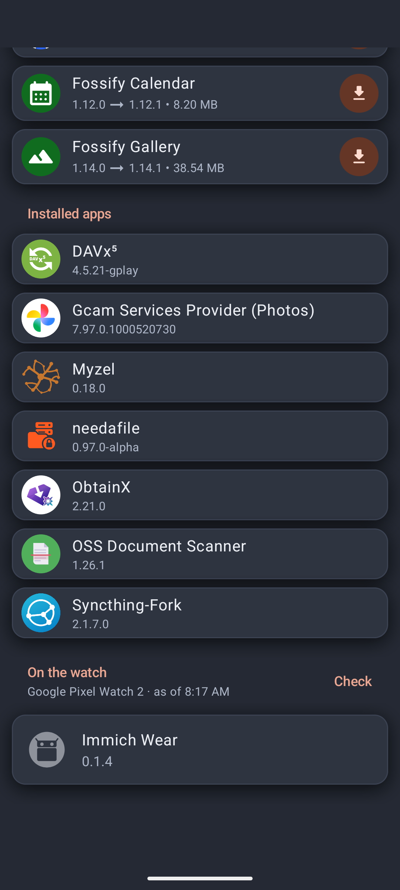<br><sub>My apps: the apps on the watch</sub></td>
  </tr>
</table>

<table>
  <tr>
    <td align="center">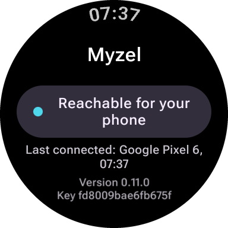<br><sub>Myzel on the watch: reachable for the phone</sub></td>
    <td align="center">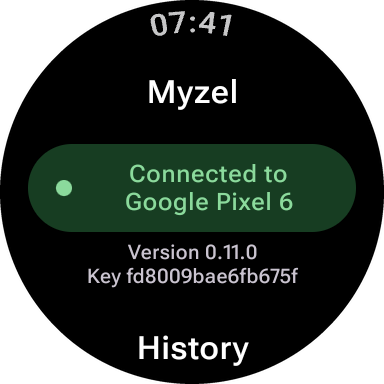<br><sub>Connected to the phone</sub></td>
  </tr>
</table>

## Features

### Apps

- Discover, search, install and update apps, automatically in the background if you like
- Categories, “Recently updated” and “New apps” on the start page
- App page with versions, changes, signature, license and anti-features (ads, tracking …)
- “My apps” with updates, installed apps and installation history
- Installation via Android's package installer or without asking via root or Shizuku

### Repositories

- F-Droid, IzzyOnDroid and the repository of needanapp.de are switched on
- About 40 more well-known repositories (among them Guardian Project, microG, NewPipe) can be switched on with one
  switch
- Add your own repositories by QR code or address, also with a login and your own mirrors
- If an app is in several repositories, their order decides which one is preferred

### Wear OS watch

- Set up the watch once via “Wireless debugging”: Myzel installs Myzel on the watch and exchanges a key
- After that Myzel installs, updates and removes apps on the watch over Bluetooth, without a cable and without the
  Play Store
- Category “Watch” for apps with a watch version, the apps on the watch with their updates under “My apps”
- After an installation on the phone, Myzel asks whether the app should go onto the watch too
- Tested with the Google Pixel Watch 2

### Favorites and backup

- Mark apps as favorites with the Myzel symbol on their page
- Back up repositories, favorites, settings and appearance in one file and restore them on another device (without
  passwords)

### Appearance

- Two styles: “NeedAnApp” (default) is the calm card look of needanapp.de; “Myzel” looks like a device, with
  aluminium in light and graphite in dark mode, orange as signal color and black displays in a dot-matrix font
- Own color worlds for light and dark (among them Paper, Latte, Nord Night, Midnight, Hi-Vis, Copper) and a freely
  chosen signal color; all text stays easy to read in every combination
- Navigation in a floating pill at the bottom, swipe between Discover, Search and My apps; the Myzel is the menu
  button
- Categories in Discover as a panel with all groups at a glance
- Light, dark or like the system, pure black, motion and UI scaling
- German and English

No ads, no tracking, no crash reports.

## Based on and thanks to

- [F-Droid client](https://gitlab.com/fdroid/fdroidclient) – the base of Myzel
- The people running F-Droid, IzzyOnDroid and all other repositories
- [libadb-android](https://github.com/MuntashirAkon/libadb-android) – ADB connection to the watch during setup
- [Shizuku](https://github.com/RikkaApps/Shizuku-API) – installation without asking
- needanapp-design – the interface, the design package of needanapp.de

## License

Myzel is free software under the GNU General Public License, version 3 or later, see [LICENSE](LICENSE). The design
package needanapp-design is under the GNU General Public License, version 3. F-Droid's libraries under `libs/` are
under the [Apache License 2.0](libs/LICENSE).

Some of F-Droid's icons come from [Picol](http://www.flaticon.com/authors/picol),
[Icomoon](http://www.flaticon.com/authors/icomoon) and [Dave Gandy](http://www.flaticon.com/authors/dave-gandy) via
[Flaticon](http://www.flaticon.com) or from Google and are under
[CC BY 3.0](https://creativecommons.org/licenses/by/3.0/); others come from the
[Material Design Icons](https://github.com/google/material-design-icons) under
[CC BY 4.0](https://creativecommons.org/licenses/by/4.0/).
