<p align="center">
  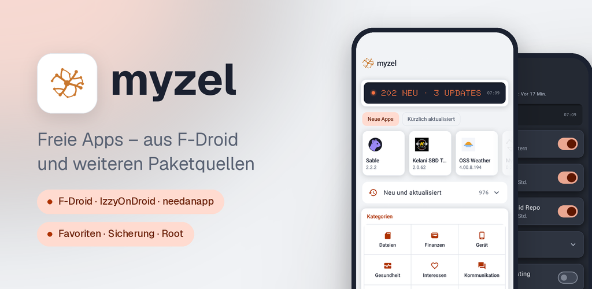
</p>

# Myzel

**App-Store für freie Software aus F-Droid-Paketquellen – auch für Wear-OS-Uhren**

Myzel ist ein App-Store für Android 12 und neuer. Du findest darin freie und quelloffene Apps aus F-Droid,
IzzyOnDroid und weiteren Paketquellen, installierst sie und hältst sie aktuell – auf dem Handy und auf der Uhr.
Myzel basiert auf dem offiziellen F-Droid-Client und übernimmt dessen Updates, trägt aber das Design von
needanapp.de.

[F-Droid-Repo](https://apps.needanapp.de) · [Myzel im Repo](https://apps.needanapp.de/de.needanapp.myzel/) ·
Android 12 und neuer · Wear OS 3 und neuer · Lizenz [GPL-3.0](LICENSE) · Herausgeber needanapp.de

## Installieren

Myzel gibt es im F-Droid-Repo von needanapp.de. Füge in einer F-Droid-App (F-Droid, Droid-ify, Neo Store …)
unter „Paketquellen“ diese Adresse hinzu oder scanne auf [apps.needanapp.de](https://apps.needanapp.de)
den QR-Code, dann installiere Myzel. Danach aktualisiert sich Myzel selbst.

```text
https://apps.needanapp.de/repo?fingerprint=35453386642F44485E4D556E1F631A1F2AD22CA3B02FB2C72B0A9807E5B30488
```

Fingerabdruck (SHA-256) des Repo-Schlüssels:
`35 45 33 86 64 2F 44 48 5E 4D 55 6E 1F 63 1A 1F 2A D2 2C A3 B0 2F B2 C7 2B 0A 98 07 E5 B3 04 88`

Bis Oktober 2026 lag Myzel unter fdroid.needanapp.de. Das ist jetzt die Testing-Quelle mit Vorabversionen
und verlangt eine Anmeldung. Hast du nur sie eingetragen, füge apps.needanapp.de wie oben hinzu; ab Myzel
0.22.0 geschieht das beim ersten Start von selbst.

Die App ist signiert mit dem Schlüssel von needanapp.de (SHA-256 des Zertifikats):
`C6:0E:A3:B5:6D:A7:0E:60:EF:F5:CB:96:DD:8D:C1:9A:41:86:0A:3E:D4:B2:9A:EB:2A:29:9F:83:3A:63:51:D9`

Bis 0.21.1 trug Myzel einen anderen Schlüssel (`4C:A4:F7:4F:…:D6:FE:D5:47:02`), den die Vorabversionen aus der
Testing-Quelle weiter tragen. Eine ältere Installation lässt sich deshalb nicht auf 0.22.0 aktualisieren: Sichere
deine Einstellungen unter Einstellungen › Sicherung, deinstalliere Myzel einmal und installiere es aus
apps.needanapp.de neu; Myzel Wear auf der Uhr ebenso.

Die App für die Uhr musst du nicht selbst installieren: Myzel holt sie bei der Einrichtung der Uhr aus derselben
Paketquelle und hält sie danach aktuell.

## Warnung von Google Play Protect

Auf Handys mit Google-Diensten kann Play Protect Myzel als „schädliche App“ oder „unsichere App“ melden, die
Installation blockieren oder später vorschlagen, Myzel zu deinstallieren. Myzel ist keine Schadsoftware. Die Warnung
hat zwei Gründe:

- **ADB für die Uhr:** Um Myzel auf eine Wear-OS-Uhr zu bringen, enthält Myzel einen ADB-Client
  ([libadb-android](https://github.com/MuntashirAkon/libadb-android)). Das ist dieselbe Technik, mit der Entwickler über
  „Debugging über WLAN“ Apps auf ein Gerät spielen. Play Protect stuft Apps, die das können, pauschal als riskant ein,
  besonders wenn sie nicht aus dem Play Store kommen.
- **Rechte eines App-Stores:** Myzel installiert, aktualisiert und entfernt Apps und sieht dafür, welche Apps
  installiert sind. Das brauchen alle App-Stores, Play Protect bewertet es bei unbekannten Apps trotzdem streng.

Was Myzel mit ADB macht und was nicht:

- ADB kommt nur bei der Einrichtung der Uhr zum Einsatz, und die startest du selbst: Du schaltest auf der Uhr
  „Debugging über WLAN“ ein und gibst den Kopplungscode der Uhr in Myzel ein.
- Myzel verbindet sich dabei nur mit einer Uhr. Ein Handy oder Tablet mit „Debugging über WLAN“ lehnt es ab.
- Auf der Uhr installiert Myzel nur Myzel Wear, gibt ihm die nötigen Rechte (Bluetooth, Benachrichtigungen, Apps
  installieren) und übergibt einen Schlüssel. Danach schaltet Myzel „Debugging über WLAN“ auf der Uhr wieder ab. Alles
  Weitere läuft über Bluetooth zwischen Myzel und Myzel Wear.
- Auf dem Handy selbst nutzt Myzel kein ADB. Myzel schickt keine Daten an Dritte und enthält keine Werbung, kein
  Tracking und keine Absturzberichte.
- Der Quellcode liegt offen in diesem Repository, und die App ist mit dem Schlüssel von needanapp.de signiert
  (Fingerabdruck oben unter „Installieren“).

So installierst du Myzel trotzdem:

1. Lade Myzel nur aus apps.needanapp.de oder von den Releases dieser Seite. Wer sichergehen will, vergleicht die
   Signatur der APK mit dem Fingerabdruck oben, etwa mit `apksigner verify --print-certs myzel-<version>.apk`.
2. Erscheint beim Installieren die Warnung von Play Protect, tippe auf „Weitere Details“ und dann auf „Trotzdem
   installieren“. Die Bezeichnungen unterscheiden sich je nach Android-Version leicht. Ob du die App zur Prüfung an
   Google schickst, kannst du frei entscheiden; an Myzel ändert das nichts.
3. Hat Play Protect die Installation ganz blockiert oder Myzel deaktiviert: Öffne den Play Store, tippe oben rechts
   auf dein Profilbild, dann auf „Play Protect“ und das Zahnrad, und schalte „Apps mit Play Protect scannen“
   vorübergehend aus. Installiere Myzel und schalte die Prüfung danach wieder ein. Meldet Play Protect Myzel später
   noch einmal, wähle dort, dass du die App behalten möchtest.

## Bilder

<table>
  <tr>
    <td align="center" width="25%">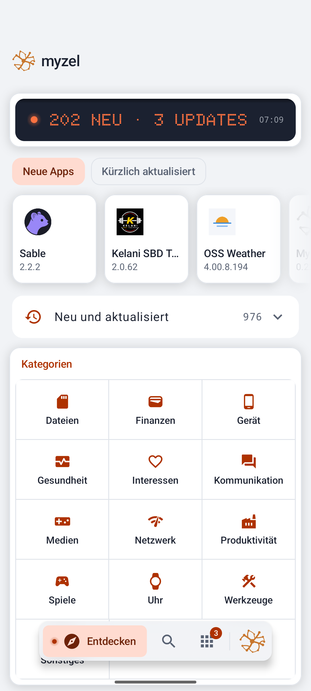<br><sub>Entdecken: neue und aktualisierte Apps, Kategorien</sub></td>
    <td align="center" width="25%">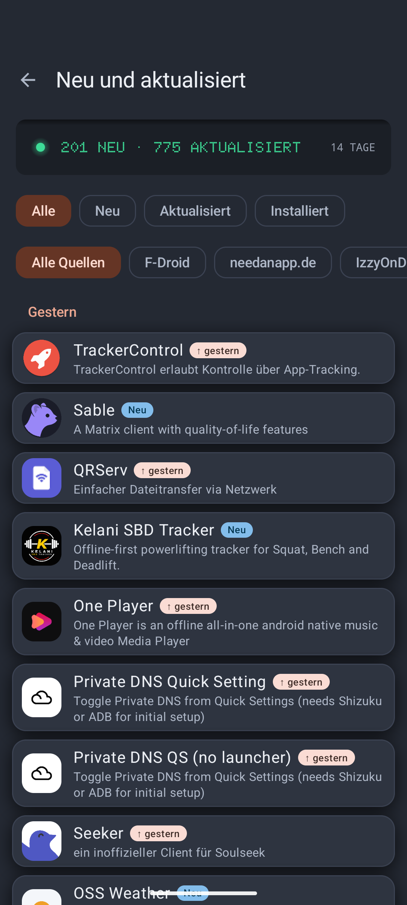<br><sub>Neu und aktualisiert, über alle Paketquellen</sub></td>
    <td align="center" width="25%">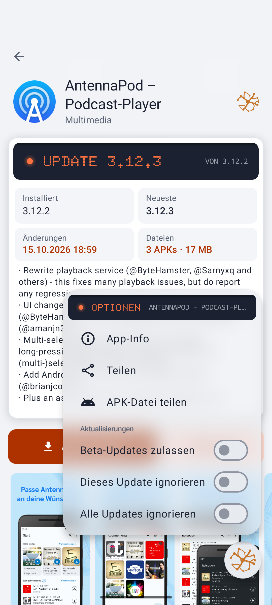<br><sub>App-Seite mit Optionen: Beta-Updates, Update ignorieren</sub></td>
    <td align="center" width="25%">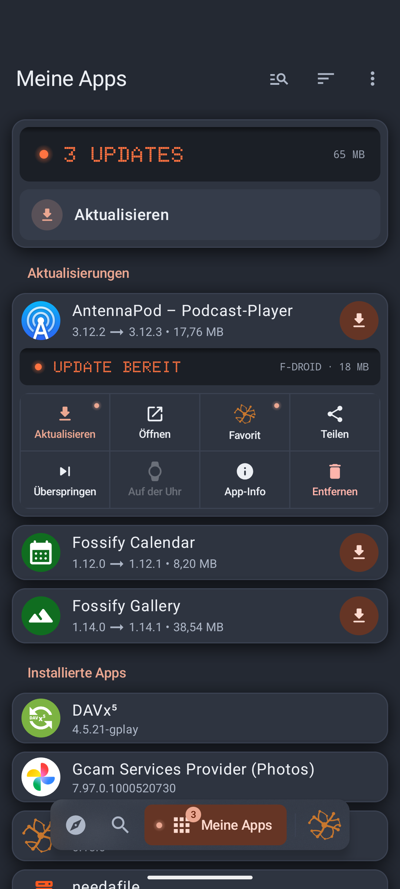<br><sub>Meine Apps: Menü beim langen Drücken auf eine App</sub></td>
  </tr>
  <tr>
    <td align="center" width="25%">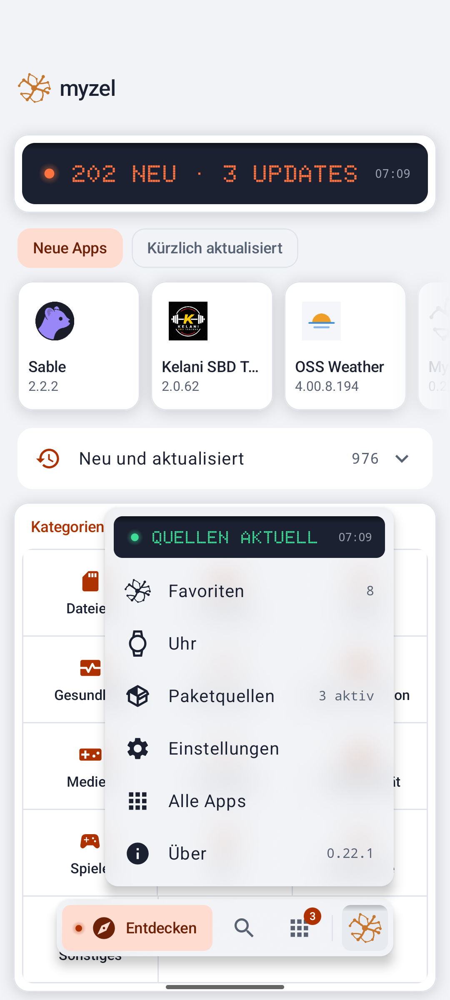<br><sub>Das Myzel-Menü: Favoriten, Uhr, Paketquellen</sub></td>
    <td align="center" width="25%">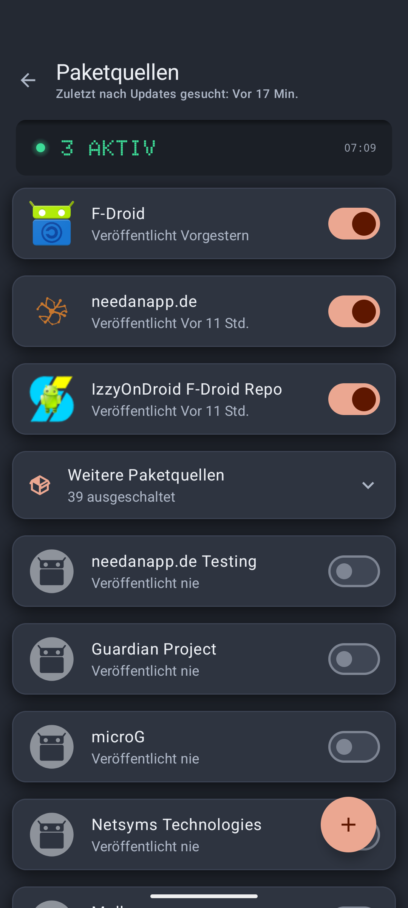<br><sub>Paketquellen ein- und ausschalten oder hinzufügen</sub></td>
    <td align="center" width="25%">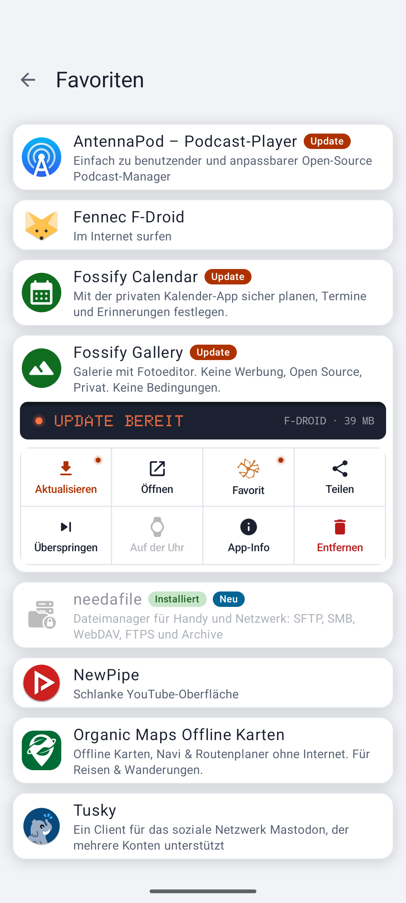<br><sub>Favoriten mit dem Menü beim langen Drücken</sub></td>
    <td align="center" width="25%">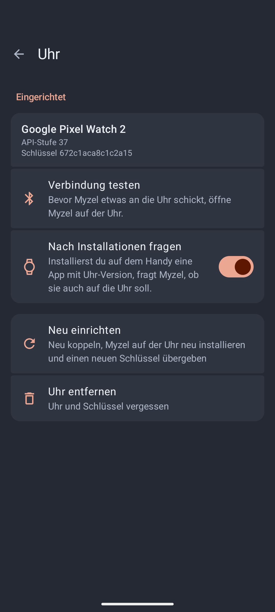<br><sub>Wear-OS-Uhr einrichten und Verbindung testen</sub></td>
  </tr>
  <tr>
    <td align="center" width="25%">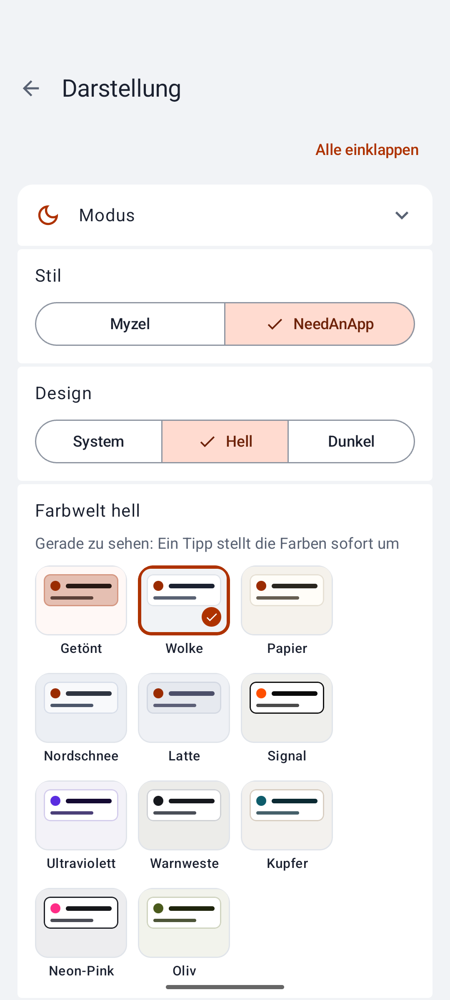<br><sub>Darstellung: Stil, hell, dunkel, Farbwelten</sub></td>
    <td align="center" width="25%">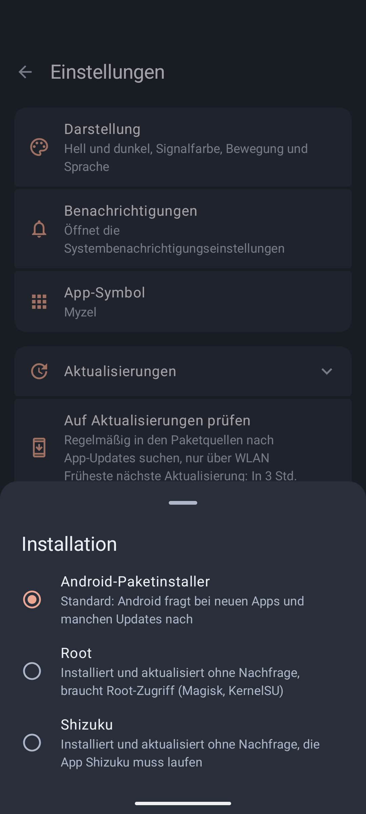<br><sub>Installieren ohne Nachfrage über Root oder Shizuku</sub></td>
    <td align="center" width="25%">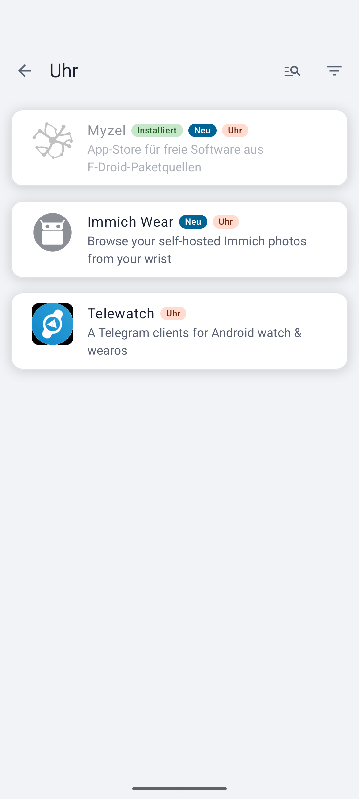<br><sub>Rubrik „Uhr“: Apps mit Uhr-Version</sub></td>
    <td align="center" width="25%">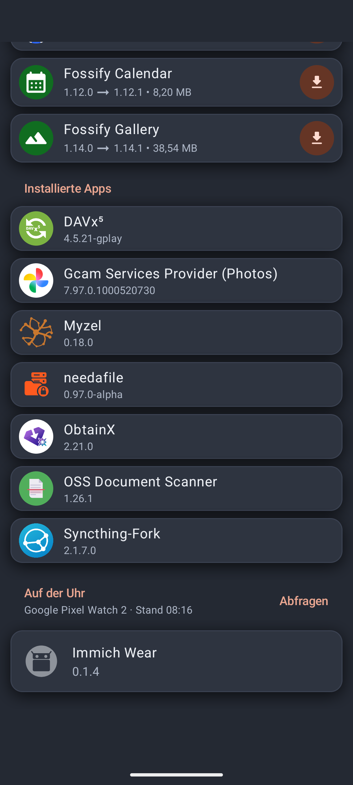<br><sub>Meine Apps: die Apps auf der Uhr</sub></td>
  </tr>
</table>

<table>
  <tr>
    <td align="center">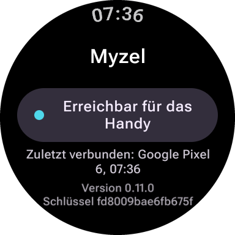<br><sub>Myzel auf der Uhr: erreichbar für das Handy</sub></td>
    <td align="center">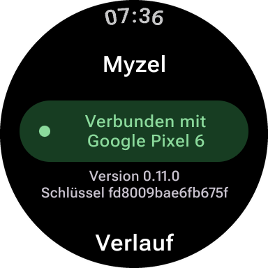<br><sub>Verbunden mit dem Handy</sub></td>
  </tr>
</table>

## Funktionen

### Apps

- Apps entdecken, suchen, installieren und aktualisieren, auf Wunsch automatisch im Hintergrund
- Kategorien, „Kürzlich aktualisiert“ und „Neue Apps“ auf der Startseite
- App-Seite mit Versionen, Änderungen, Signatur, Lizenz und unerwünschten Merkmalen (Werbung, Tracking …)
- „Meine Apps“ mit Updates, installierten Apps und Installationsverlauf
- Installation über den Paketinstaller von Android oder ohne Nachfrage über Root oder Shizuku

### Paketquellen

- F-Droid, IzzyOnDroid und die Paketquelle von needanapp.de sind eingeschaltet
- Rund 40 weitere bekannte Paketquellen (u. a. Guardian Project, microG, NewPipe) lassen sich mit einem Schalter
  einschalten
- Eigene Paketquellen per QR-Code oder Adresse hinzufügen, auch mit Anmeldung und eigenen Spiegelservern
- Gibt es eine App in mehreren Paketquellen, bestimmt die Reihenfolge, welche bevorzugt wird

### Wear-OS-Uhr

- Die Uhr einmal über „Debugging über WLAN“ einrichten: Myzel installiert dabei Myzel auf der Uhr und tauscht
  einen Schlüssel aus
- Danach installiert, aktualisiert und entfernt Myzel Apps auf der Uhr über Bluetooth, ohne Kabel und ohne
  Play Store
- Rubrik „Uhr“ für Apps mit Uhr-Version, die Apps auf der Uhr samt Updates unter „Meine Apps“
- Nach einer Installation auf dem Handy fragt Myzel, ob die App auch auf die Uhr soll
- Getestet mit der Google Pixel Watch 2

### Favoriten und Sicherung

- Apps mit dem Myzel-Symbol auf ihrer Seite als Favoriten markieren
- Paketquellen, Favoriten, Einstellungen und Darstellung in einer Datei sichern und auf einem anderen Gerät
  einspielen (ohne Passwörter)

### Darstellung

- Zwei Stile: „Myzel“ sieht aus wie ein Gerät, mit Alu im hellen und Graphit im dunklen Modus, Orange als
  Signalfarbe und schwarzen Anzeigen in Punktmatrix-Schrift; „NeedAnApp“ ist der ruhige Kartenlook von needanapp.de
- Eigene Farbwelten für hell und dunkel (u. a. Papier, Latte, Nordnacht, Mitternacht, Warnweste, Kupfer) und eine
  frei wählbare Signalfarbe; alle Schriften bleiben in jeder Kombination gut lesbar
- Navigation in einer schwebenden Pille unten, zwischen Entdecken, Suche und Meine Apps auch per Wischen; das
  Myzel ist der Menüknopf
- Kategorien in Entdecken als Bedienfeld mit allen Gruppen auf einen Blick
- Hell, dunkel oder wie das System, reines Schwarz, Bewegung und UI-Skalierung
- Deutsch und Englisch

Keine Werbung, kein Tracking, keine Absturzberichte.

## Grundlage und Dank

- [F-Droid-Client](https://gitlab.com/fdroid/fdroidclient) – Grundlage von Myzel
- Die Betreiber von F-Droid, IzzyOnDroid und allen weiteren Paketquellen
- [libadb-android](https://github.com/MuntashirAkon/libadb-android) – ADB-Verbindung zur Uhr bei der Einrichtung
- [Shizuku](https://github.com/RikkaApps/Shizuku-API) – Installation ohne Nachfrage
- needanapp-design – die Oberfläche, das Design-Paket von needanapp.de

## Lizenz

Myzel ist freie Software unter der GNU General Public License, Version 3 oder neuer, siehe [LICENSE](LICENSE).
Das Design-Paket needanapp-design steht unter der GNU General Public License, Version 3. Die Bibliotheken von
F-Droid unter `libs/` stehen unter der [Apache License 2.0](libs/LICENSE).

Einige Symbole von F-Droid stammen von [Picol](http://www.flaticon.com/authors/picol),
[Icomoon](http://www.flaticon.com/authors/icomoon) und [Dave Gandy](http://www.flaticon.com/authors/dave-gandy)
über [Flaticon](http://www.flaticon.com) oder von Google und stehen unter
[CC BY 3.0](https://creativecommons.org/licenses/by/3.0/); weitere stammen aus den
[Material Design Icons](https://github.com/google/material-design-icons) unter
[CC BY 4.0](https://creativecommons.org/licenses/by/4.0/).
