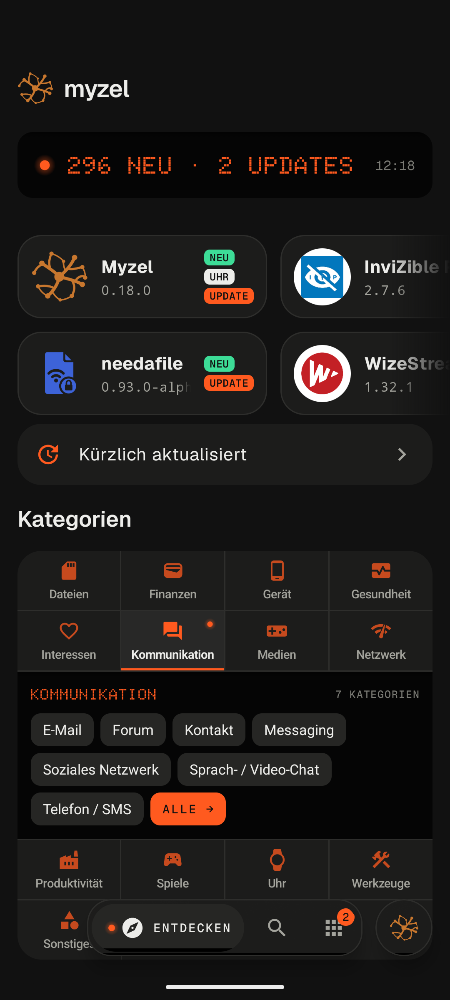
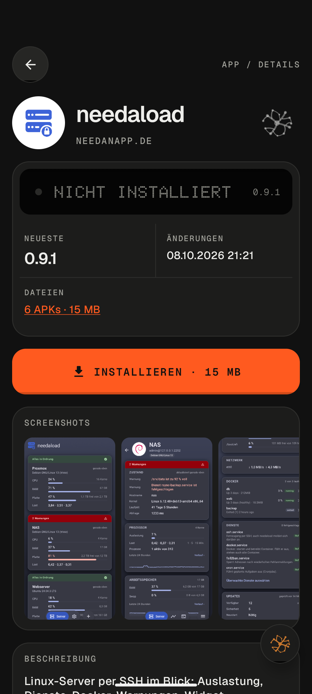
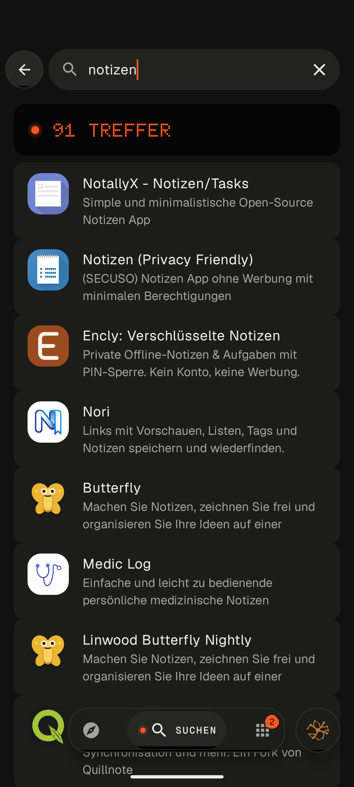
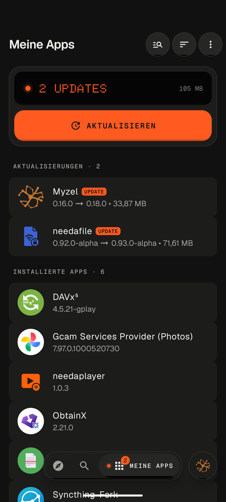
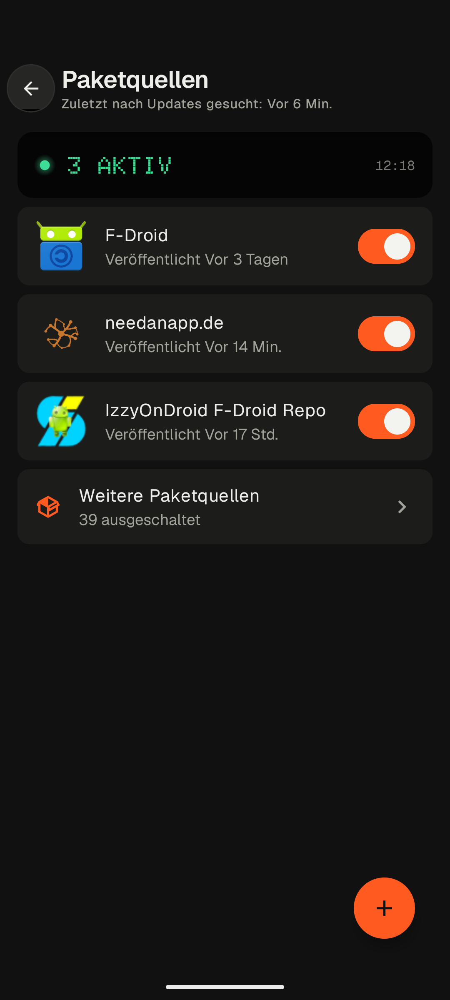
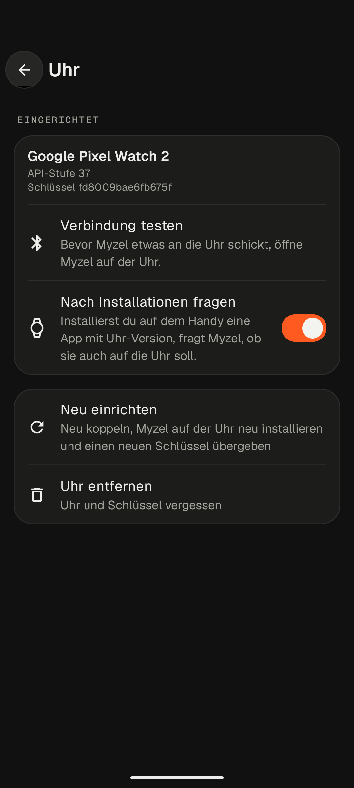
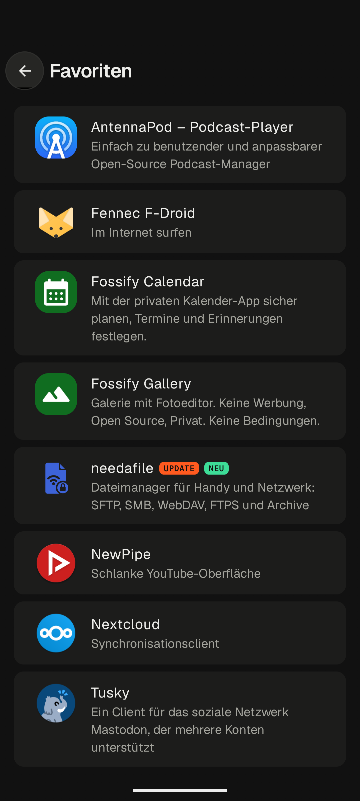
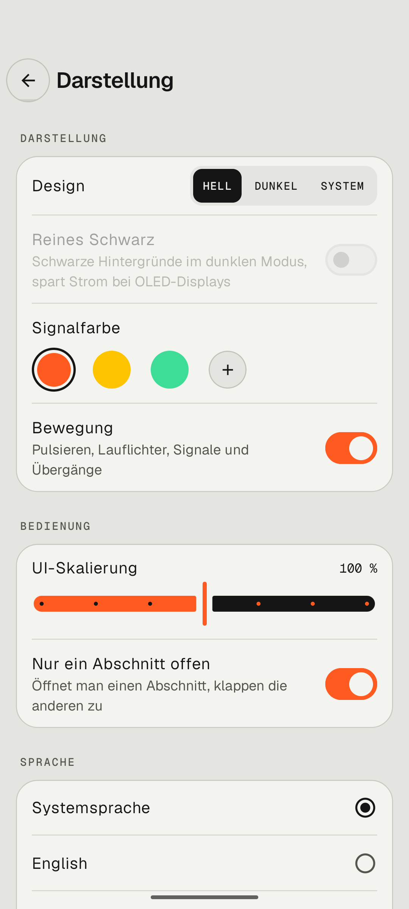

<p align="center">
  
</p>

# Myzel

**App-Store für freie Software aus F-Droid-Paketquellen – auch für Wear-OS-Uhren**

Myzel ist ein App-Store für Android 12 und neuer. Du findest darin freie und quelloffene Apps aus F-Droid,
IzzyOnDroid und weiteren Paketquellen, installierst sie und hältst sie aktuell – auf dem Handy und auf der Uhr.
Myzel basiert auf dem offiziellen F-Droid-Client und übernimmt dessen Updates, trägt aber das Design von
needanapp.de.

[F-Droid-Repo](https://apps.needanapp.de) · [Myzel im Repo](https://apps.needanapp.de/de.needanapp.myzel/) ·
Android 12 und neuer · Wear OS 3 und neuer · Lizenz [GPL-3.0](LICENSE) · Herausgeber needanapp.de

## Installieren

Myzel gibt es im F-Droid-Repo von needanapp.de. Füge in einer F-Droid-App (F-Droid, Droid-ify, Neo Store …)
unter „Paketquellen“ diese Adresse hinzu oder scanne auf [apps.needanapp.de](https://apps.needanapp.de)
den QR-Code, dann installiere Myzel. Danach aktualisiert sich Myzel selbst.

```text
https://apps.needanapp.de/repo?fingerprint=35453386642F44485E4D556E1F631A1F2AD22CA3B02FB2C72B0A9807E5B30488
```

Fingerabdruck (SHA-256) des Repo-Schlüssels:
`35 45 33 86 64 2F 44 48 5E 4D 55 6E 1F 63 1A 1F 2A D2 2C A3 B0 2F B2 C7 2B 0A 98 07 E5 B3 04 88`

Bis Oktober 2026 lag Myzel unter fdroid.needanapp.de. Das ist jetzt die Testing-Quelle mit Vorabversionen
und verlangt eine Anmeldung. Hast du nur sie eingetragen, füge apps.needanapp.de wie oben hinzu; ab Myzel
0.22.0 geschieht das beim ersten Start von selbst.

Die App ist signiert mit dem Schlüssel von needanapp.de (SHA-256 des Zertifikats):
`C6:0E:A3:B5:6D:A7:0E:60:EF:F5:CB:96:DD:8D:C1:9A:41:86:0A:3E:D4:B2:9A:EB:2A:29:9F:83:3A:63:51:D9`

Bis 0.21.1 trug Myzel einen anderen Schlüssel (`4C:A4:F7:4F:…:D6:FE:D5:47:02`), den die Vorabversionen aus der
Testing-Quelle weiter tragen. Eine ältere Installation lässt sich deshalb nicht auf 0.22.0 aktualisieren: Sichere
deine Einstellungen unter Einstellungen › Sicherung, deinstalliere Myzel einmal und installiere es aus
apps.needanapp.de neu; Myzel Wear auf der Uhr ebenso.

Die App für die Uhr musst du nicht selbst installieren: Myzel holt sie bei der Einrichtung der Uhr aus derselben
Paketquelle und hält sie danach aktuell.

## Bilder

<table>
  <tr>
    <td align="center" width="25%"><br><sub>Entdecken: neue und aktualisierte Apps, Kategorien</sub></td>
    <td align="center" width="25%"><br><sub>App-Seite mit Versionen, Signatur und Details</sub></td>
    <td align="center" width="25%"><br><sub>Suche über alle Paketquellen</sub></td>
    <td align="center" width="25%"><br><sub>Meine Apps: Updates und installierte Apps</sub></td>
  </tr>
  <tr>
    <td align="center" width="25%"><br><sub>Paketquellen ein- und ausschalten oder hinzufügen</sub></td>
    <td align="center" width="25%"><br><sub>Wear-OS-Uhr einrichten und Verbindung testen</sub></td>
    <td align="center" width="25%"><br><sub>Favoriten</sub></td>
    <td align="center" width="25%"><br><sub>Darstellung: hell, dunkel, Signalfarbe und mehr</sub></td>
  </tr>
</table>

<table>
  <tr>
    <td align="center"><br><sub>Myzel auf der Uhr: erreichbar für das Handy</sub></td>
    <td align="center"><br><sub>Verbunden mit dem Handy</sub></td>
  </tr>
</table>

## Funktionen

### Apps

- Apps entdecken, suchen, installieren und aktualisieren, auf Wunsch automatisch im Hintergrund
- Kategorien, „Kürzlich aktualisiert“ und „Neue Apps“ auf der Startseite
- App-Seite mit Versionen, Änderungen, Signatur, Lizenz und unerwünschten Merkmalen (Werbung, Tracking …)
- „Meine Apps“ mit Updates, installierten Apps und Installationsverlauf
- Installation über den Paketinstaller von Android oder ohne Nachfrage über Root oder Shizuku

### Paketquellen

- F-Droid, IzzyOnDroid und die Paketquelle von needanapp.de sind eingeschaltet
- Rund 40 weitere bekannte Paketquellen (u. a. Guardian Project, microG, NewPipe) lassen sich mit einem Schalter
  einschalten
- Eigene Paketquellen per QR-Code oder Adresse hinzufügen, auch mit Anmeldung und eigenen Spiegelservern
- Gibt es eine App in mehreren Paketquellen, bestimmt die Reihenfolge, welche bevorzugt wird

### Wear-OS-Uhr

- Die Uhr einmal über „Debugging über WLAN“ einrichten: Myzel installiert dabei Myzel auf der Uhr und tauscht
  einen Schlüssel aus
- Danach installiert, aktualisiert und entfernt Myzel Apps auf der Uhr über Bluetooth, ohne Kabel und ohne
  Play Store
- Rubrik „Uhr“ für Apps mit Uhr-Version, die Apps auf der Uhr samt Updates unter „Meine Apps“
- Nach einer Installation auf dem Handy fragt Myzel, ob die App auch auf die Uhr soll
- Getestet mit der Google Pixel Watch 2

### Favoriten und Sicherung

- Apps mit dem Myzel-Symbol auf ihrer Seite als Favoriten markieren
- Paketquellen, Favoriten, Einstellungen und Darstellung in einer Datei sichern und auf einem anderen Gerät
  einspielen (ohne Passwörter)

### Darstellung

- Aussehen wie ein Gerät: Alu im hellen, Graphit im dunklen Modus, Orange als Signalfarbe, schwarze Anzeigen
  in Punktmatrix-Schrift
- Navigation in einer schwebenden Pille unten, zwischen Entdecken, Suche und Meine Apps auch per Wischen; das
  Myzel ist der Menüknopf
- Kategorien in Entdecken als Bedienfeld mit allen Gruppen auf einen Blick
- Hell, dunkel oder wie das System, reines Schwarz, Signalfarbe, Bewegung und UI-Skalierung
- Deutsch und Englisch

Keine Werbung, kein Tracking, keine Absturzberichte.

## Für Entwickler

### Aufbau

Myzel ist ein Fork des [F-Droid-Clients](https://gitlab.com/fdroid/fdroidclient) 2.0.1 (Variante *basic*). Der
Branch `myzel` ist der Stand von Myzel, `master` folgt F-Droid. Damit Updates von F-Droid leicht übernommen
werden können, ändert Myzel möglichst wenig an Dateien von F-Droid:

- Eigener Code liegt unter `app/src/main/kotlin/de/needanapp/myzel/`. Bildschirme und Bausteine von F-Droid
  werden über ihre Import-Zeilen gegen die von Myzel getauscht (`myzel/tools/apply-imports.py`, prüfen mit
  `--check`).
- Eigene Texte stehen in `app/src/main/res/values*/myzel_strings.xml`; Name, Symbol und angepasste Texte von
  F-Droid überschreibt `app/src/myzel/res/`. Build-Abweichungen sammelt `app/myzel.gradle`.
- `myzel/wear/` ist Myzel Wear, die App für die Uhr; `myzel/link/` die Verbindung zwischen Handy und Uhr über
  Bluetooth.
- Das Design kommt aus dem Paket [needanapp-design](https://git.needanapp.de/needanapp.de/needanapp-design)
  (Git-Submodul `myzel/needanapp-design`, Zweig `geraet`).

Die ausführliche Beschreibung (Bildschirme, Uhr-Protokoll, Messen, Veröffentlichen, Updates von F-Droid
übernehmen) steht in [myzel/README.md](myzel/README.md).

### Bauen

```bash
git clone --recurse-submodules https://git.needanapp.de/needanapp.de/myzel.git
cd myzel
./gradlew :app:assembleBasicDefaultDebug :myzel-wear:assembleDebug
```

Gebaut wird mit JDK 21 und dem Android SDK (compileSdk 37). Die Debug-Variante heißt `de.needanapp.myzel.debug`
und lässt sich neben Myzel installieren. Release-Builds (`:app:assembleBasicDefaultRelease`) signiert
needanapp.de; ohne den Schlüssel bleiben sie unsigniert.

```bash
./gradlew :app:testBasicDefaultDebugUnitTest :myzel-link:testDebugUnitTest
./gradlew :app:ktfmtFormatMain :app:ktfmtFormatTest
```

## Grundlage und Dank

- [F-Droid-Client](https://gitlab.com/fdroid/fdroidclient) (GPL-3.0-or-later) – Grundlage von Myzel, samt der
  Bibliotheken unter `libs/`
- Die Betreiber von F-Droid, IzzyOnDroid und allen weiteren Paketquellen
- [libadb-android](https://github.com/MuntashirAkon/libadb-android) – ADB-Verbindung zur Uhr bei der Einrichtung
- [Shizuku](https://github.com/RikkaApps/Shizuku-API) – Installation ohne Nachfrage
- [needanapp-design](https://git.needanapp.de/needanapp.de/needanapp-design) (Apache-2.0) – Oberfläche

## Lizenz

Myzel ist freie Software unter der GNU General Public License, Version 3 oder neuer, siehe [LICENSE](LICENSE).
Das Design-Paket needanapp-design steht unter Apache 2.0.

Einige Symbole von F-Droid stammen von [Picol](http://www.flaticon.com/authors/picol),
[Icomoon](http://www.flaticon.com/authors/icomoon) und [Dave Gandy](http://www.flaticon.com/authors/dave-gandy)
über [Flaticon](http://www.flaticon.com) oder von Google und stehen unter
[CC BY 3.0](https://creativecommons.org/licenses/by/3.0/); weitere stammen aus den
[Material Design Icons](https://github.com/google/material-design-icons) unter
[CC BY 4.0](https://creativecommons.org/licenses/by/4.0/).
